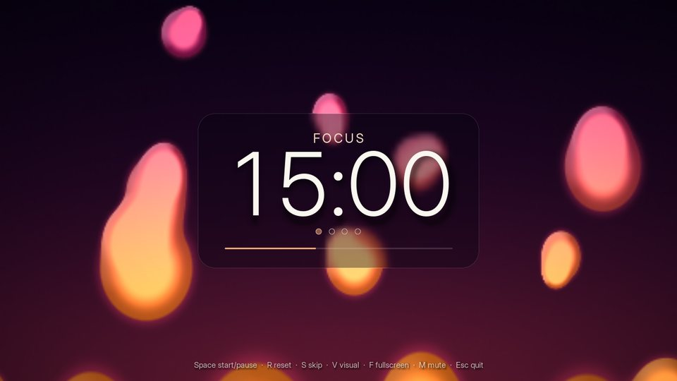
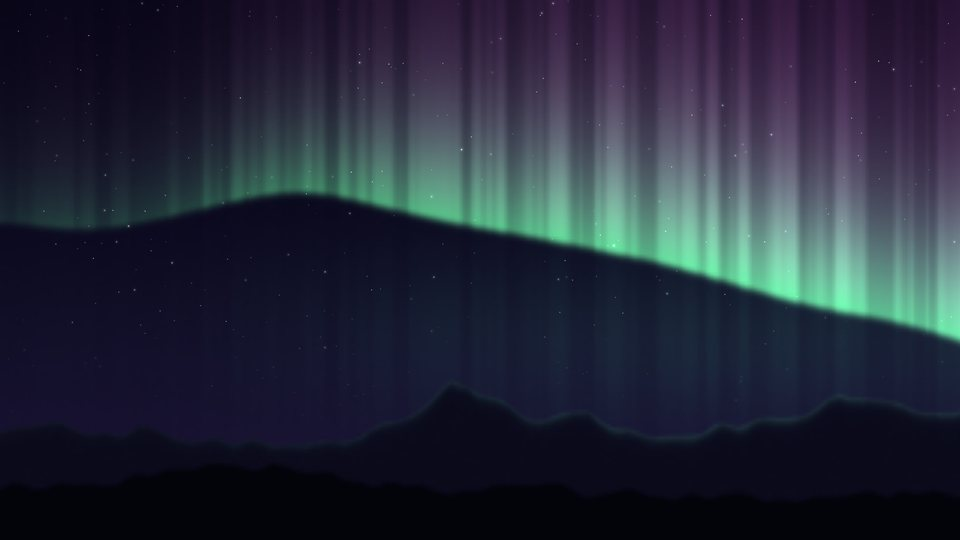
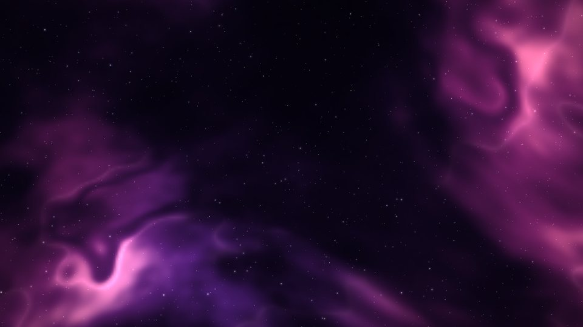
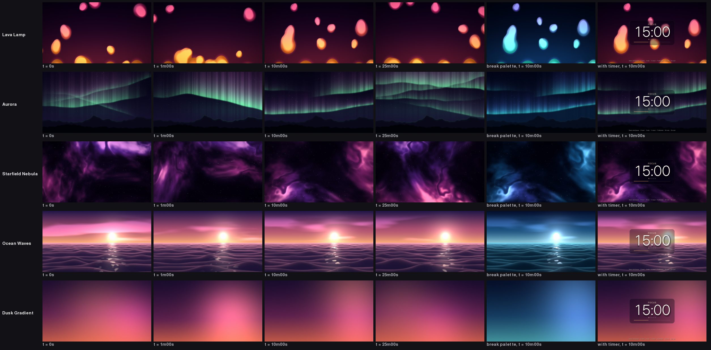

# Ambient Pomodoro

A desktop Pomodoro timer that sits over slowly evolving generative backgrounds.
These include a lava lamp, an aurora, a drifting nebula and a calm sea. The
visuals are built to stay interesting for a whole 25-minute session without
visibly repeating. Their palette warms up while you focus and cools down on
breaks.



| Aurora | Starfield Nebula | Ocean Waves (break palette) |
| --- | --- | --- |
|  |  |  |

All scenes at t = 0 s, 1 min, 10 min and 25 min, plus the break palette and
the timer overlay:



## Features

- **Pomodoro cycle.** 25-minute focus, 5-minute short break, and a 15-minute
  long break after every 4 focus sessions. All of it is configurable.
- **Big, legible countdown.** It sits on a frosted-glass panel with a soft drop
  shadow, alongside the session type, the cycle dots (●●○○) and a progress bar.
  Digits are laid out in fixed-width cells, so the countdown doesn't jitter.
- **Chime.** A gentle bell chime plays at the end of each session. It is
  synthesized with NumPy, so no audio files are needed. A descending phrase
  means time to rest; an ascending one means back to work.
- **Five scenes.** They crossfade when you switch and shift palette smoothly
  between focus and break.
- **Persistent settings.** Durations, last visual, mute and window size are
  saved to a JSON file in your user config directory.
- **Adaptive quality.** On slower machines, scenes lower their internal
  resolution to stay smooth.

## Install and run

You need **Python 3.11 or newer**. The only dependencies are `pygame-ce` and
`numpy`.

### macOS

```bash
cd ambient-pomodoro
python3 -m venv .venv
source .venv/bin/activate
pip install -r requirements.txt
python main.py
```

If `python3 --version` shows something older than 3.11, install a current
Python from [python.org](https://www.python.org/downloads/macos/) or with
`brew install python@3.12`. pygame-ce ships wheels for Apple Silicon and
Intel, so nothing needs compiling.

### Windows

```powershell
cd ambient-pomodoro
py -3 -m venv .venv
.venv\Scripts\activate
pip install -r requirements.txt
python main.py
```

Get Python from [python.org](https://www.python.org/downloads/windows/) and
tick **"Add python.exe to PATH"** during setup. If PowerShell refuses to run
the activate script, run
`Set-ExecutionPolicy -Scope CurrentUser RemoteSigned` once, or use
`.venv\Scripts\activate.bat` from `cmd.exe`.

### As a package

`pip install .` from this folder installs an `ambient-pomodoro` command.
`python -m pomodoro` also works.

## Controls

| Key | Action |
| --- | --- |
| **Space** | Start / pause (clicking the timer panel works too) |
| **R** | Reset the current session |
| **S** | Skip to the next session |
| **V** / **Shift+V** | Next / previous visual |
| **F** | Toggle fullscreen |
| **M** | Mute / unmute the chime |
| **Esc** | Quit |

The key hints at the bottom fade away while the timer runs and come back when
you move the mouse or pause. The window title always shows the remaining time,
so you can keep an eye on it from the taskbar or dock.

Skipping counts as finishing the session, so skipping a focus session still
advances the cycle dots toward the long break. By default the next session
starts automatically when one ends (`--no-auto-start` changes that).

## Configuration

Command-line options override the saved settings and **become your new
defaults**:

```bash
python main.py --focus 50 --short 10 --long 20 --cycle 3   # 50/10 rhythm, long break every 3
python main.py --scene aurora --fullscreen
python main.py --fps 30          # lighter on battery
python main.py --show-fps        # FPS counter (and render quality, if lowered)
python main.py --list-scenes
```

Settings are stored as JSON at:

| OS | Location |
| --- | --- |
| macOS | `~/Library/Application Support/AmbientPomodoro/settings.json` |
| Windows | `%APPDATA%\AmbientPomodoro\settings.json` |
| Linux | `$XDG_CONFIG_HOME/ambient-pomodoro/settings.json` (default `~/.config/...`) |

Set `AMBIENT_POMODORO_CONFIG` or pass `--config PATH` to use another file. The
file is safe to hand-edit. Unknown keys are ignored, and an invalid value only
resets that one field.

```json
{
  "auto_start": true,
  "focus_minutes": 25.0,
  "fps": 60,
  "long_break_minutes": 15.0,
  "muted": false,
  "scene": "lava_lamp",
  "sessions_before_long_break": 4,
  "short_break_minutes": 5.0,
  "volume": 0.6,
  "window_height": 720,
  "window_width": 1280
}
```

## The visuals

Every scene's picture is a pure function of its clock, its seed and the
focus/break "mood". Long sessions can't drift numerically, and the snapshot
tool can jump straight to minute 25. To avoid visible loops, motion comes from
smooth noise over an **infinite, hashed lattice**, which never repeats, unlike
a 256-entry Perlin table. Where sinusoids are used, they have mutually
incommensurate periods.

- **Lava Lamp (`lava_lamp`).** The wax is metaballs on a compact Wyvill kernel
  `(1 − d²/R²)³`. Blobs fuse with a smooth neck that thins and snaps as they
  separate. Each blob has its own 85–170 s rise/sink cycle, perturbed by slow
  noise, so blobs hesitate and overtake one another. Wax pools under the bottom
  edge, so new blobs bud off it and merge into a film at the top. The wax is
  hot orange near the heater and cools to magenta as it rises, with a glossy
  rim highlight and a soft glow.
- **Aurora (`aurora`).** Curtains hang from noise-driven base lines that fold,
  tilt and cross over minutes. Each has a sharp green lower border fading to
  violet, two scales of shimmering rays, and segments that brighten and fade.
  They hang over ridged-noise mountains and a twinkling star field.
- **Starfield Nebula (`nebula`).** A domain-warped fractal cloud with ridged
  filaments and dark dust lanes. Three star layers drift with parallax along a
  camera path that never retraces itself, with the occasional faint meteor.
- **Ocean Waves (`ocean`).** Swells recede in perspective under a low sun, or
  under a moon in the cool palette. Crest lines are sums of travelling waves
  with incommensurate wavenumbers. The faces reflect the sky more toward the
  horizon (Fresnel), and a glitter path sparkles beneath the sun.
- **Dusk Gradient (`dusk`).** A minimal, nearly free scene: drifting colour
  stops and two soft light orbs. It's the simplest example to copy.

### Adding a scene

1. Create `pomodoro/scenes/my_scene.py` with a `Scene` subclass. It needs a
   unique `key` and `title`, plus `update(dt)` and `draw(surface)`. For NumPy
   effects, subclass `FieldScene` and return a planar `(3, h, w)` float image
   from `render()`. The base class handles the reduced internal resolution,
   dithering, smooth upscaling and adaptive quality.
2. Add the class to `SCENES` in `pomodoro/scenes/__init__.py`.

```python
import numpy as np
from .base import FieldScene, mix_palette

class PulseScene(FieldScene):
    key = "pulse"
    title = "Pulse"

    def render(self):
        pal = mix_palette({"c": (255, 140, 90)}, {"c": (90, 170, 255)}, self.mood)
        glow = np.exp(-((self.u - self.aspect / 2) ** 2 + (self.v - 0.5) ** 2) / 0.1)
        return pal["c"] * (glow * (0.6 + 0.4 * np.sin(self.t / 7.0)))[None]
```

The scene test suite runs on every registered scene automatically. It checks
rendering, change over time, determinism, the palette shift, odd window sizes,
multi-hour timestamps and a 5-minute playthrough.

## Development

```bash
pip install -r requirements-dev.txt
python -m pytest                       # 120+ tests: timer logic, settings, audio, noise, scenes, app input
python main.py --render-frames         # PNG snapshots of every scene -> snapshots/
python main.py --render-frames --scenes aurora --times 0,30,90 --size 1920x1080
python main.py --benchmark             # frame time per scene at 1920x1080
```

`--render-frames` and `--benchmark` run headless (`SDL_VIDEODRIVER=dummy`), so
they work over SSH and on CI. The snapshots include `<scene>_t<sec>s.png`
(focus palette), `<scene>_break.png`, `<scene>_ui.png` (with the timer
overlay) and a `contact_sheet.png`.

### Performance

The benchmark ran headless at 1920×1080 on a 4-core 2.8 GHz Xeon VM, which is
roughly a mid-range laptop core. "+UI" includes the timer overlay. The display
flip isn't included.

| Scene | Internal res | avg ms | p95 ms | +UI ms | ≈ fps |
| --- | --- | --- | --- | --- | --- |
| Lava Lamp | 640×360 | 14.3 | 17.6 | 17.0 | 59 |
| Aurora | 480×270 | 11.9 | 13.8 | 14.5 | 69 |
| Starfield Nebula | 384×216 | 8.2 | 19.6 | 10.7 | 94 |
| Ocean Waves | 480×270 | 12.7 | 15.3 | 15.1 | 66 |
| Dusk Gradient | 160×90 | 2.3 | 2.9 | 4.3 | 234 |

How it stays fast without per-pixel Python loops:

- **Reduced internal resolution.** Heavy effects are computed at 1/3–1/6 of the
  window size with vectorized NumPy, then smooth-upscaled by pygame's SIMD
  `smoothscale`.
- **Separable noise.** Sampling noise on a pixel grid is two small matrix
  products (`Wy @ L(t) @ Wx.T`), which is 10–50× cheaper than per-pixel Perlin
  noise in NumPy. BLAS is pinned to one thread, which is faster for small
  matrices and leaves the other cores free.
- **One BLAS call per frame for colour.** Scenes build grayscale weight masks
  and mix their colours in a single call (`compose`), instead of many
  memory-bound full-colour array passes.
- **Nebula keyframes.** The nebula renders 5 keyframes per second and
  interpolates its masks in between, which is invisible at under a pixel of
  motion per second.
- **Crisp, cheap stars.** Stars are pre-rendered sprites blitted additively at
  full resolution.
- **Smooth scene switches.** The next scene is built on a worker thread, and
  the previous one fades out as a still snapshot.
- **Adaptive quality.** If frames stay over budget, internal resolution drops in
  15% steps, to a 50% floor. It recovers when there's headroom again.

## Project layout

```
ambient-pomodoro/
├── main.py                 # entry point: python main.py
├── pyproject.toml          # package metadata, `ambient-pomodoro` command
├── requirements.txt
├── pomodoro/
│   ├── timer.py            # pure timer state machine (no pygame)
│   ├── settings.py         # JSON settings in the platform config dir
│   ├── audio.py            # synthesized chimes
│   ├── noise.py            # vectorized hashed-lattice B-spline noise
│   ├── ui.py               # frosted timer panel, toasts, hints
│   ├── app.py              # window, input, main loop, crossfades, quality governor
│   ├── devtools.py         # --render-frames and --benchmark
│   ├── cli.py              # argument parsing
│   └── scenes/
│       ├── __init__.py     # the scene registry
│       ├── base.py         # Scene / FieldScene, compose(), keyframing
│       ├── stars.py        # full-resolution star sprites
│       ├── lava_lamp.py
│       ├── aurora.py
│       ├── nebula.py
│       ├── ocean.py
│       └── gradient.py     # Dusk
└── tests/
```
